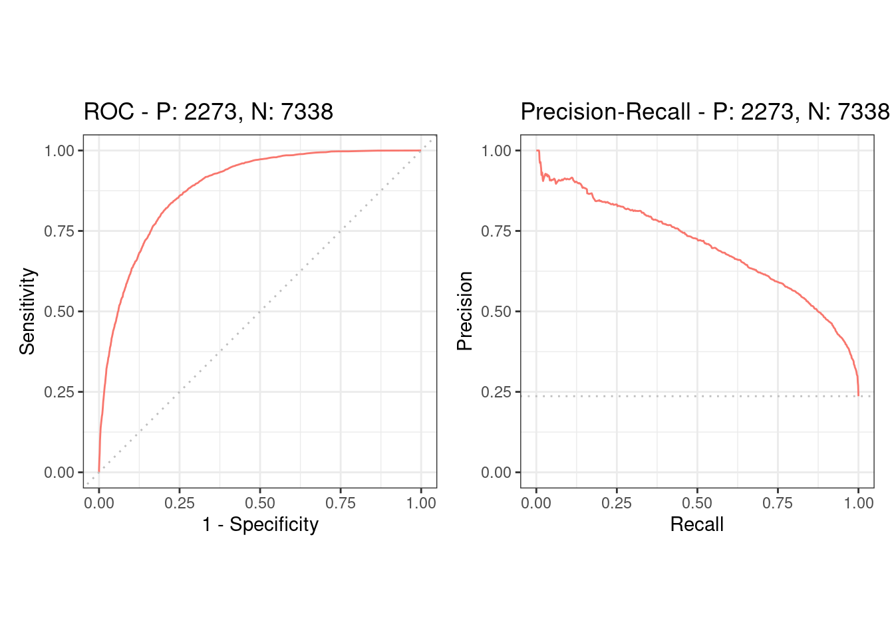

# m6APrediction

## Overview

m6APrediction is an R package that predicts m6A sites using a trained random forest model. It supports prediction for a single sample or multiple samples.

The package includes a fitted model and example input data.

## Installation

Install the package from GitHub:

```r
install.packages("remotes")
remotes::install_github("violet-qing/m6APrediction")
```

Load the package:

```r
library(m6APrediction)
```

## Input data

The input data should contain the following columns:

| Column | Description |
|---|---|
| gc_content | GC content |
| RNA_type | mRNA, lincRNA, lncRNA or pseudogene |
| RNA_region | CDS, intron, 3'UTR or 5'UTR |
| exon_length | Exon length |
| distance_to_junction | Distance to the splice junction |
| evolutionary_conservation | Evolutionary conservation score |
| DNA_5mer | Five-nucleotide DNA sequence using uppercase A, T, C and G |

## Usage

### Load the model and example data

```r
library(m6APrediction)

model <- readRDS(system.file(
  "extdata", "rf_fit.rds", package = "m6APrediction"
))

example_data <- read.csv(system.file(
  "extdata", "m6A_input_example.csv", package = "m6APrediction"
))
```

### Predict multiple samples

```r
multiple_results <- prediction_multiple(
  ml_fit = model,
  feature_df = example_data,
  positive_threshold = 0.5
)

head(multiple_results)
```

The output contains the original input columns and two additional columns:

- `predicted_m6A_prob`: the predicted probability of the Positive class.
- `predicted_m6A_status`: Positive if the probability is greater than the threshold; otherwise Negative.

### Predict a single sample

```r
single_result <- prediction_single(
  ml_fit = model,
  gc_content = example_data$gc_content[1],
  RNA_type = example_data$RNA_type[1],
  RNA_region = example_data$RNA_region[1],
  exon_length = example_data$exon_length[1],
  distance_to_junction = example_data$distance_to_junction[1],
  evolutionary_conservation =
    example_data$evolutionary_conservation[1],
  DNA_5mer = example_data$DNA_5mer[1],
  positive_threshold = 0.5
)

single_result
```

The output is a character vector containing the predicted probability and class.

## Model performance

The following ROC and precision-recall curves show the random forest model performance on the evaluation data.



The ROC curve shows sensitivity against the false positive rate.
The precision-recall curve shows the relationship between precision and recall, which is useful for evaluating imbalanced data.

## License

MIT license.

## Author

Yunnuo Zhang
